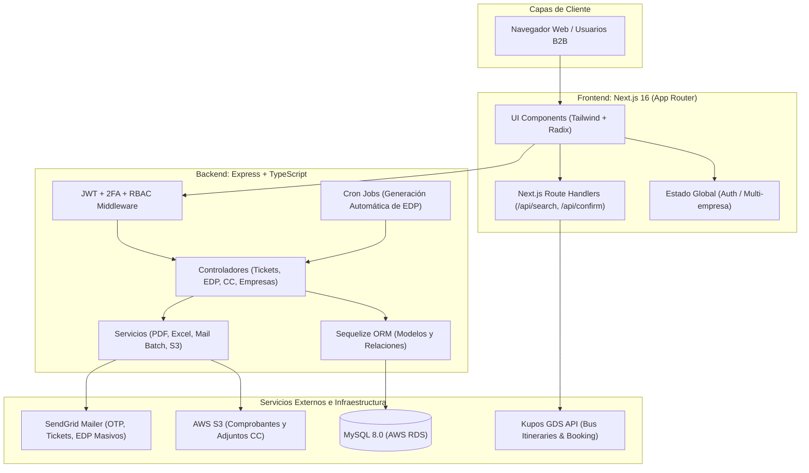
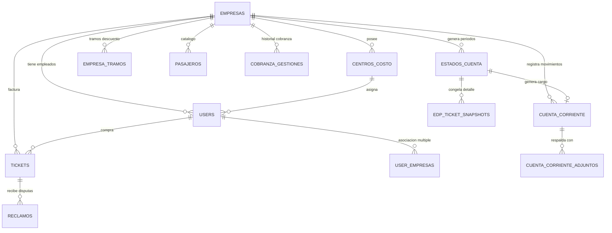
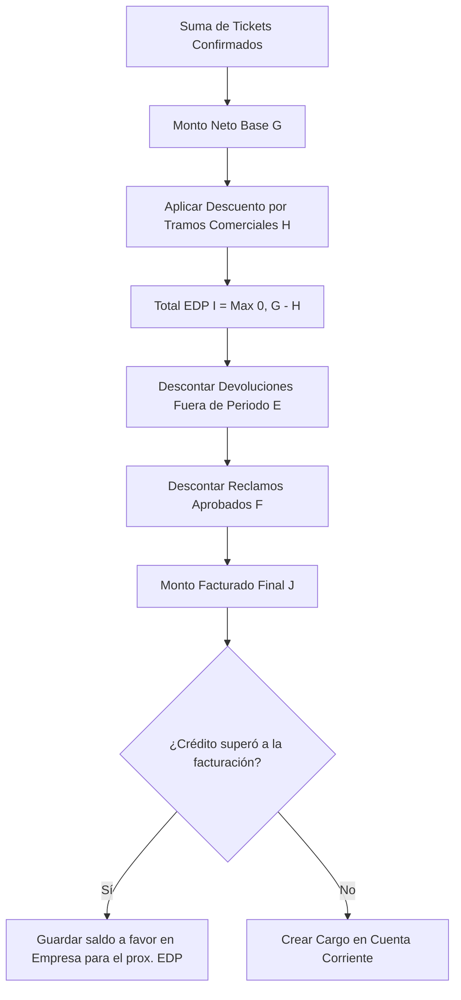

# 📘 Manual Integral del Sistema: Plataforma de Reservas Corporativas (Pullman Bus - WIT)

> **Documento Oficial de Arquitectura, Operación, Negocio y Guía Técnica**  
> **Versión:** 2.0 (Actualizada con corte contable Julio 2026 y snapshots inmutables)  
> **Organizaciones:** GRUPO PULLMAN BUS & WIT SPA Servicios Tecnológicos  

---

## 📑 Tabla de Contenidos

1. [Visión General del Proyecto](#1-visión-general-del-proyecto)
2. [Arquitectura Global de la Solución](#2-arquitectura-global-de-la-solución)
3. [Ecosistema Tecnológico y Stack](#3-ecosistema-tecnológico-y-stack)
4. [Estructura del Proyecto y Repositorios](#4-estructura-del-proyecto-y-repositorios)
5. [Modelo de Datos y Base de Datos (MySQL / Sequelize)](#5-modelo-de-datos-y-base-de-datos-mysql--sequelize)
6. [Matriz de Roles, Seguridad y Control de Acceso](#6-matriz-de-roles-seguridad-y-control-de-acceso)
7. [Integraciones Externas](#7-integraciones-externas)
   - [7.1. Motor de Pasajes Kupos (GDS Bus)](#71-motor-de-pasajes-kupos-gds-bus)
   - [7.2. Almacenamiento en la Nube: AWS S3](#72-almacenamiento-en-la-nube-aws-s3)
   - [7.3. Mensajería Transaccional: SendGrid](#73-mensajería-transaccional-sendgrid)
8. [Módulos Principales del Negocio](#8-módulos-principales-del-negocio)
   - [8.1. Motor de Reservas y Venta Corporativa](#81-motor-de-reservas-y-venta-corporativa)
   - [8.2. Anulaciones y Devoluciones (Política del 20%)](#82-anulaciones-y-devoluciones-política-del-20)
   - [8.3. Cuenta Corriente y Gestión de Cobranza](#83-cuenta-corriente-y-gestión-de-cobranza)
   - [8.4. Estados de Pago (EDP), Descuentos por Tramos y Rollover](#84-estados-de-pago-edp-descuentos-por-tramos-y-rollover)
   - [8.5. Congelamiento Inmutable de EDPs (Snapshots)](#85-congelamiento-inmutable-de-edps-snapshots)
   - [8.6. Módulo de Reclamos](#86-módulo-de-reclamos)
   - [8.7. Módulo de Auditoría y Reportabilidad](#87-módulo-de-auditoría-y-reportabilidad)
9. [Flujos Operacionales del Frontend](#9-flujos-operacionales-del-frontend)
10. [Instalación, Configuración y Despliegue](#10-instalación-configuración-y-despliegue)
11. [Scripts de Utilidad y Mantenimiento](#11-scripts-de-utilidad-y-mantenimiento)
12. [Preguntas Frecuentes y Troubleshooting](#12-preguntas-frecuentes-y-troubleshooting)

---

## 1. Visión General del Proyecto

La **Plataforma de Reservas Corporativas** es una solución integral B2B desarrollada conjuntamente por **Pullman Bus** y **WIT SPA**. Su propósito primordial es permitir a empresas clientes reservar, gestionar y controlar los pasajes terrestres de sus colaboradores de manera centralizada, sin requerir pagos directos por boleto en el momento de la compra.

### Objetivos Clave
- **Venta B2B Centralizada:** Conectar las solicitudes de pasajes corporativos con el motor central de **Kupos (GDS Bus)**.
- **Facturación Periódica (EDP):** En lugar de cobro unitario inmediato, agrupar todos los consumos mensuales o quincenales en **Estados de Pago (EDP)** consolidados para cobro por factura a la empresa cliente.
- **Control de Presupuesto y Centros de Costo:** Asignación de viajes por centro de costo, usuario y pasajero para control contable granular.
- **Límites de Crédito y Morosidad:** Validación automática del cupo disponible de cada empresa previo a emitir cualquier pasaje.
- **Trazabilidad y Auditoría:** Auditoría financiera completa e inmutable de los movimientos contables, cargos, abonos y snapshots históricos.

---

## 2. Arquitectura Global de la Solución

El sistema opera bajo un esquema desacoplado **Frontend (Next.js)** + **Backend (Node.js/Express)** + **BBDD Relacional (MySQL en AWS RDS)** + **Servicios Cloud (AWS S3 & SendGrid)** + **Kupos GDS API**.



---

## 3. Ecosistema Tecnológico y Stack

### Frontend (`Reservas-Corporativas`)
- **Framework:** Next.js 16 (App Router, React 19).
- **Lenguaje:** TypeScript 5+.
- **Estilos y Componentes:** Tailwind CSS, Radix UI primitives, Lucide React Icons.
- **Manejo de Estado:** Zustand (con persistencia en `localStorage`).
- **Formularios y Validaciones:** React Hook Form + Zod.
- **Visualización y Documentos:** Recharts, jsPDF, HTML2Canvas.
- **Notificaciones:** Sonner, SweetAlert2.

### Backend (`backend-reservas-corporativas`)
- **Entorno:** Node.js 18+ / 20+ con Express 4.21.
- **Lenguaje:** TypeScript 5+ compilado con `tsc` / `ts-node-dev`.
- **ORM y Persistencia:** Sequelize 6 + `sequelize-typescript` conectado a MySQL 8.
- **Autenticación y Seguridad:** JWT (`jsonwebtoken`), cifrado `bcrypt`, verificación de IP/Proxy, protección de borrado accidental de BBDD.
- **Procesamiento de Documentos:** `exceljs` (planillas financieras avanzadas) y `pdf-lib` (reportes vectoriales de alta precisión).
- **Integraciones:** AWS SDK v3 (`@aws-sdk/client-s3`), SendGrid Mail (`@sendgrid/mail`).
- **Documentación:** Swagger UI (`/api-docs`).

---

## 4. Estructura del Proyecto y Repositorios

El espacio de trabajo se compone de dos repositorios principales:

```
c:\NodeJs\reservas corporativas\
├── backend-reservas-corporativas/     # API REST, Lógica de Negocio y Cron
│   ├── src/
│   │   ├── controllers/               # Controladores HTTP (Tickets, EDP, CC, Users, etc.)
│   │   ├── cron/                      # Tareas programadas nocturnas (generación de EDP)
│   │   ├── database.ts                # Conexión Sequelize, Timezone y barrera de seguridad
│   │   ├── index.ts                   # Servidor Express, CORS y montaje de rutas
│   │   ├── middleware/                # Autenticación JWT, verificación de roles y permisos
│   │   ├── models/                    # Definición de tablas y decoradores Sequelize
│   │   ├── routes/                    # Declaración de endpoints REST
│   │   ├── script/                    # Utilidades de mantenimiento, migración y pruebas
│   │   └── services/                  # Mail, PDF, Excel, S3, Sinceramiento de Saldos
│   ├── swagger.json                   # Especificación OpenAPI
│   └── package.json                   # Dependencias y scripts del Backend
│
└── Reservas-Corporativas/             # Aplicación Web Frontend (Next.js)
    ├── app/                           # Rutas y páginas de la aplicación (App Router)
    │   ├── admin/                     # Administración de empresa cliente
    │   ├── admincc/                   # Administración de cuenta corriente
    │   ├── api/                       # Proxies locales hacia API de Kupos
    │   ├── auditoria/                 # Vista de auditoría (solo lectura)
    │   ├── bookings/                  # Proceso de compra, checkout y confirmación
    │   ├── controller/                # Panel de contraloría y finanzas
    │   ├── dashboard/                 # Métricas e indicadores de rendimiento
    │   ├── login/                     # Inicio de sesión y 2FA
    │   ├── portal/                    # Buscador principal de pasajes
    │   └── superuser/                 # Panel global de administración de empresas
    ├── components/                    # Componentes modulares de interfaz
    ├── lib/                           # Store de autenticación (auth.ts), generadores PDF
    └── package.json                   # Dependencias y scripts del Frontend
```

---

## 5. Modelo de Datos y Base de Datos (MySQL / Sequelize)

El backend utiliza Sequelize con soporte para relaciones relacionales estrictas y control multi-inquilino.

### Tablas Principales

| Tabla | Modelo | Descripción |
|---|---|---|
| `empresas` | `Empresa` | Datos de la empresa cliente, RUT, recargo comercial, porcentaje de devolución, día de facturación/vencimiento, tipo de facturación (`Masiva` o `Especial`), límite de crédito (`monto_maximo`), estado de morosidad y créditos pendientes arrastrados. |
| `empresa_tramos` | `EmpresaTramo` | Escalas comerciales de descuento por volumen de compra asignadas a cada empresa. |
| `centros_costo` | `CentroCosto` | Unidades de negocio o departamentos para imputar los viajes de una empresa. |
| `users` | `User` | Credenciales, rol asignado, estado (activo/inactivo), empresa asociada y secret 2FA. |
| `user_empresas` | `UserEmpresa` | Permite que un usuario pertenezca a múltiples empresas (ejecutivos comerciales o auditores). |
| `roles_permisos` | `RolPermiso` | Matriz granular de permisos por módulo y acción para cada rol. |
| `pasajeros` | `Pasajero` | Libreta de pasajeros frecuentes por empresa (RUT, nombre, email, teléfono). |
| `tickets` | `Ticket` | Pasajes confirmados o anulados (PNR Kupos, número de boleto, origen, destino, asientos, tarifas, usuario y empresa). |
| `estados_cuenta` | `EstadoCuenta` | Estados de Pago (EDP) emitidos, período, tickets incluidos, montos brutos, descuentos, devoluciones fuera de período y estado de pago. |
| `edp_ticket_snapshots` | `EdpTicketSnapshot` | Copia inmutable congelada en JSON del detalle de cada ticket al momento exacto de emisión del EDP. |
| `cuenta_corriente` | `CuentaCorriente` | Libro contable de movimientos (cargos por EDP y abonos por transferencias/pagos). |
| `cuenta_corriente_adjuntos` | `CuentaCorrienteAdjunto` | Comprobantes de pago, HES, facturas o notas de compra subidos a S3 y asociados al movimiento contable. |
| `cobranza_gestiones` | `CobranzaGestion` | Bitácora de seguimiento de cobranza (llamadas, compromisos de pago, cartas, alertas). |
| `reclamos` | `Reclamo` | Disputas o reclamos sobre tickets que, al ser aprobados, generan notas de crédito automáticas en el próximo EDP. |

### Diagrama Entidad-Relación Conceptual



### Barrera de Seguridad Crítica en Base de Datos
En `src/database.ts` existe un **guardrail programático inviolable**: si el host no es local (`localhost`), la función `sequelize.sync({ force: true })` es interceptada y arroja un error fatal antes de ejecutarse, impidiendo la destrucción accidental de tablas en RDS AWS.

---

## 6. Matriz de Roles, Seguridad y Control de Acceso

El acceso se rige por autenticación JWT combinada con el middleware dinámico `checkPermission` y la tabla `roles_permisos`.

### Perfiles de Usuario

1. **`superuser`:** Control total de la plataforma. Administración global de empresas, configuración de comisiones/tramos, creación de administradores y acceso a todos los módulos.
2. **`admin` (Administrador de Empresa):** Gestiona su propia empresa, subusuarios, centros de costo, visualiza el historial consolidado de pasajes de su empresa y puede anular pasajes.
3. **`empresa`:** Perfil corporativo intermedio con facultades de compra y revisión de pasajes de la empresa.
4. **`subusuario` (Comprador Operativo):** Destinado al colaborador que adquiere boletos para sí mismo o su equipo. Solo visualiza los pasajes comprados por él.
5. **`contralor` (Finanzas / Facturación):** Especialista financiero. Ejecuta y revisa Estados de Pago (EDP), prepara información para facturación, gestiona estados de cuenta y marca EDPs como facturados/cerrados.
6. **`admincc` (Administrador de Cuenta Corriente):** Gestiona cargos, abonos, subida de comprobantes de pago (HES, facturas) y revisión de saldos de las empresas.
7. **`auditoria`:** Perfil de supervisión financiera y operacional. Tiene acceso transversal de **solo lectura** a reportes, movimientos y trazabilidad.
8. **`soporte`:** Atención a incidencias y monitoreo de operaciones de clientes.

### Flujo de Autenticación y 2FA
1. **Credenciales:** El usuario ingresa email y contraseña.
2. **Validación de Caducidad de Contraseña:** Se verifica la vigencia de la clave; si ha expirado, se obliga al cambio antes de otorgar acceso.
3. **Doble Factor (2FA):** Si `ENABLE_2FA=true`, el backend genera un código OTP numérico temporal, lo guarda de forma encriptada y lo despacha al correo registrado mediante SendGrid.
4. **Emisión de JWT:** Al validar el OTP en el endpoint `/api/auth/verify-2fa`, se emite el token JWT que contiene el `id`, `email`, `rol`, `empresa_id` y `owner` (`Pullman` | `Wit`).

---

## 7. Integraciones Externas

### 7.1. Motor de Pasajes Kupos (GDS Bus)
La plataforma no opera una flota propia en el software, sino que consume en tiempo real las APIs de Kupos para disponibilidad de recorridos, tarifas y confirmación de asientos:
- **Ambientes:**
  - **QA:** `https://newstg3-gdsbus.kupos.cl/gds/api`
  - **Producción:** `https://gds.kupos.com/gds/api`
- **Endpoints Consumidos:**
  - `GET /cities.json` — Catálogo de terminales y ciudades.
  - `POST /search.json` — Búsqueda de servicios por origen, destino y fecha.
  - `GET /service_details/{service_id}.json` — Mapa de asientos, pisos y tarifas base.
  - `POST /tentative_booking/{service_id}.json` (o `book_ticket.json`) — Bloqueo preventivo de asientos (reserva temporal).
  - `POST /confirm_booking/{pnr}.json` — Emisión y confirmación definitiva del boleto.
  - `POST /cancel_ticket` — Anulación del boleto en el GDS.

> [!IMPORTANT]
> **Manejo de Descuentos y Tarifas con Kupos (Anexo Técnico `ota_discount_amount`):**  
> 1. **Tarifa Enviada a Kupos:** En las llamadas de reserva (`/api/reserve`) y confirmación (`/api/confirm`), el valor enviado en el campo `fare` es **estrictamente la tarifa base sin modificar** que Kupos entrega. Nunca se le suma el recargo comercial corporativo de la empresa.
> 2. **Descuento `ota_discount_amount`:** Kupos requiere el parámetro `ota_discount_amount` (entero numérico) dentro de cada objeto de pasajero en `seat_details`. Dado que la plataforma aplica incrementos comerciales y no descuentos en la compra base a Kupos, este campo se envía **obligatoriamente en `0`**.
> 3. **Tarifa Interna para la Empresa:** El incremento comercial (`recargo`) se calcula y almacena internamente en la base de datos en la columna `monto_boleto` del modelo `Ticket`, utilizándose para los balances de Cuenta Corriente y Estados de Pago (EDP).


### 7.2. Almacenamiento en la Nube: AWS S3
- **Bucket:** `docs-reservas-corporativas` (Región `us-east-1`).
- **Uso:** Almacenamiento seguro de archivos respaldatorios asociados a la cuenta corriente:
  - Comprobantes de transferencia / depósito.
  - Hojas de Entrada de Servicio (HES).
  - Notas de compra y notas de reserva.
  - Facturas emitidas.
- **Acceso:** URLs firmadas y claves únicas S3 estructuradas por empresa y fecha.

### 7.3. Mensajería Transaccional: SendGrid
- **Envío de 2FA:** Despacho instantáneo del código OTP para inicio de sesión.
- **Confirmación de Pasaje:** Envío automático del boleto digital en PDF al pasajero y comprador tras confirmar la reserva.
- **Despacho Masivo de EDP:** Cola asíncrona (`edpMailBatch.service.ts`) que adjunta en un único correo el **PDF Consolidado del Estado de Pago** y la **Planilla Excel detallada** para las empresas con facturación Masiva.

---

## 8. Módulos Principales del Negocio

### 8.1. Motor de Reservas y Venta Corporativa
1. **Búsqueda e Itinerarios:** El usuario selecciona origen, destino y fecha.
2. **Selección de Asientos y Validación de Pasajeros:** Se captura el RUT, nombre y centro de costo imputado.
3. **Cálculo de Incremento Comercial:**
   El valor base entregado por Kupos es incrementado según el porcentaje comercial parametrizado para la empresa:
   $$\text{Valor Final Pasaje} = \text{Tarifa Base Kupos} \times \left(1 + \frac{\text{Porcentaje Incremento}}{100}\right)$$
4. **Verificación de Cupo y Morosidad (`empresaSaldo.service.ts`):**
   Antes de confirmar, el sistema evalúa:
   $$\text{Deuda Total} = \text{Consumo Período Activo} + \text{Deuda Pendiente en Cuenta Corriente}$$
   Si $\text{Deuda Total} + \text{Valor Nuevo Pasaje} > \text{Monto Máximo Crédito}$ o si la empresa está marcada como `morosa`, **la reserva es rechazada**.

### 8.2. Anulaciones y Devoluciones (Política del 20%)
- **Regla Temporal:** La anulación solo se permite con un mínimo de **4 horas antes** de la salida del bus.
- **Retención Legal / Comercial:** De acuerdo con la normativa comercial establecida:
  - El pasaje cambia su estado a `Anulado`.
  - Se genera un **cargo de retención del 20%** sobre la tarifa base que permanece en el balance del EDP.
  - El **80% restante** es devuelto o acreditado a la empresa en su cuenta corriente o período de facturación.

### 8.3. Cuenta Corriente y Gestión de Cobranza
- **Doble Asiento Contable:**
  - **Cargos (+):** Generados automáticamente al emitirse y consolidarse un Estado de Pago (EDP).
  - **Abonos (-):** Registrados por el equipo de finanzas cuando la empresa abona o liquida transferencias.
- **Cálculo Dinámico de Saldos (Post-reinicio 2026-08-04):**
  Para garantizar cuadratura exacta al 100% y no arrastrar desajustes históricos:
  $$\text{Saldo Actual} = \sum \text{Monto Facturado EDPs} - \sum \text{Abonos Reales Realizados}$$
- **Bitácora de Cobranza (`CobranzaGestion`):** Registro de contactos telefónicos, cartas de aviso y compromisos de pago para empresas con saldo deudor vencido.

### 8.4. Estados de Pago (EDP), Descuentos por Tramos y Rollover

El ciclo de facturación se genera mensual o quincenalmente (mediante cron automático nocturno o ejecución manual por Contraloría):



#### Fórmulas de Descuento y Crédito
1. **Descuento por Tramo Comercial ($H$):**
   $$H = \text{round}\left(G \times \frac{\%\text{ Descuento}}{100}\right)$$
2. **Subtotal ($I$):**
   $$I = \max(0, G - H)$$
3. **Monto Final a Facturar ($J$):**
   $$J = \max(0, I - \text{Devoluciones Fuera Periodo} - \text{Reclamos Aprobados})$$
4. **Rollover de Saldo a Favor:**
   Si las devoluciones o reclamos pendientes superan el total del período ($J = 0$), el saldo sobrante no se pierde; se persiste en `devolucion_pendiente_edp` y `descuento_pendiente_edp` en la tabla `empresas` para ser aplicado automáticamente en el siguiente ciclo.

### 8.5. Congelamiento Inmutable de EDPs (Snapshots)
Para garantizar auditorías bancarias y tributarias sin alteraciones posteriores:
1. Al cerrarse un EDP, cada ticket y centro de costo es serializado en la tabla `edp_ticket_snapshots`.
2. Se procesan en bloques masivos de **500 en 500 registros** con **3 reintentos y retroceso exponencial**.
3. **Auditoría de Integridad Estricta:** El sistema ejecuta un `COUNT` inmediato en la base de datos:
   - Si `COUNT === tickets.length`, el EDP se aprueba y se autoriza el despacho del correo.
   - Si hay discrepancia, se emite una alerta crítica de logs y se suspende el envío del email para evitar notificar cifras incongruentes.

### 8.6. Módulo de Reclamos
- Permite a los administradores de empresa o subusuarios levantar disputas sobre pasajes no utilizados por fallas de servicio.
- Al ser revisado y marcado como **Aprobado** por Contraloría o Administración, el monto a favor se descuenta automáticamente en el cálculo del próximo EDP de la empresa.

### 8.7. Módulo de Auditoría y Reportabilidad
- **Reporte Global Consolidado:** Vista matricial de todas las empresas, períodos facturados (`2026-07`, `2026-08`, etc.), abonos recibidos y saldo neto exigible.
- **Reporte Apareado Empresa:** Visualización alineada lado a lado:
  - **Columna Izquierda:** Estados de Pago históricos (N° EDP, Período, Boletos, Descuentos, Monto Facturado).
  - **Columna Derecha:** Movimientos de Cuenta Corriente (Fecha, Referencia, Abono, Cargo, Saldo).
- **Exportaciones Idénticas:** Motores sincronizados para descarga en **Excel (.xlsx)** y **PDF Oficial**.

---

## 9. Flujos Operacionales del Frontend

### Rutas de la Aplicación Next.js

| Ruta | Acceso | Propósito |
|---|---|---|
| `/login` | Público | Autenticación con email y contraseña. |
| `/verify-otp` | Usuarios en login | Verificación del código 2FA enviado por SendGrid. |
| `/change-password` | Usuarios obligados | Actualización obligatoria de clave expirada o restablecida. |
| `/portal` | Todos autenticados | Buscador de servicios de buses (origen, destino, calendario). |
| `/bookings` | Subusuarios / Admin | Mapa interactivo de asientos, formulario de pasajeros y descarga de boletos. |
| `/dashboard` | Admin / Superuser | Gráficos y analítica de compras por período y centros de costo. |
| `/admin` | Admin de Empresa | Gestión de colaboradores internos, centros de costo y boletos de la empresa. |
| `/admincc` | AdminCC / Finanzas | Registro de abonos, cargos manuales y carga de comprobantes en S3. |
| `/controller` | Contralor / Finanzas | Generación y revisión de EDPs, control de estados (Pendiente/Facturado/Cerrado). |
| `/auditoria` | Auditor / Superuser | Auditoría de solo lectura, trazabilidad contable y estados de cuenta. |
| `/superuser` | Superuser | Alta de empresas clientes, asignación de tramos de descuento y parámetros globales. |
| `/soporte` | Todos autenticados | Centro de ayuda, documentación de tickets y contacto de soporte. |

---

## 10. Instalación, Configuración y Despliegue

### Requisitos Previos
- **Node.js:** Versión 18.x LTS o 20.x LTS.
- **Gestor de Paquetes:** `npm` (v9+) o `pnpm`.
- **Base de Datos:** MySQL 8.0+ (local o AWS RDS).
- **Cuentas y Credenciales:** Bucket AWS S3 configurado y API Key de SendGrid.

---

### Configuración del Backend (`backend-reservas-corporativas`)

1. Navegar al directorio del backend:
   ```bash
   cd "backend-reservas-corporativas"
   ```
2. Instalar dependencias:
   ```bash
   npm install
   ```
3. Configurar archivo de variables de entorno `.env`:
   ```ini
   PORT=4000
   DB_HOST=tu-rds-mysql.amazonaws.com
   DB_PORT=3306
   DB_USER=admin
   DB_PASSWORD=TuPasswordSegura
   DB_NAME=multiempresa_db

   # AWS S3 (Adjuntos y Comprobantes)
   AWS_ACCESS_KEY_ID=AKIA...
   AWS_SECRET_ACCESS_KEY=...
   AWS_REGION=us-east-1
   AWS_S3_BUCKET_NAME=docs-reservas-corporativas

   # Seguridad JWT
   JWT_SECRET=ClaveSecretaJWT_MuySegura123!
   JWT_EXPIRES_IN=12h

   # SendGrid
   SENDGRID_API_KEY=SG....
   SENDGRID_RESERVATION_TEMPLATE_ID=d-...

   # Banderas Operativas
   ENABLE_2FA=true
   ENABLE_EDP_EMAIL_DISPATCH=true
   ```
4. Iniciar en modo desarrollo:
   ```bash
   npm run dev
   ```
5. Compilar e iniciar en producción:
   ```bash
   npm run build
   npm start
   ```

---

### Configuración del Frontend (`Reservas-Corporativas`)

1. Navegar al directorio del frontend:
   ```bash
   cd "Reservas-Corporativas"
   ```
2. Instalar dependencias:
   ```bash
   npm install
   ```
3. Configurar archivo `.env`:
   ```ini
   NEXT_PUBLIC_URL_BACKEND="http://localhost:4000"
   NEXT_PUBLIC_KUPOS_ENV="prod" # o "dev" para ambiente de pruebas
   NEXT_PUBLIC_URL_KUPOS_DEV="https://newstg3-gdsbus.kupos.cl/gds/api"
   NEXT_PUBLIC_KUPOS_API_KEY_DEV="TSQFFYAPI00515538"
   NEXT_PUBLIC_URL_KUPOS_PROD="https://gds.kupos.com/gds/api"
   NEXT_PUBLIC_KUPOS_API_KEY_PROD="TSFEFSAPI80085614"
   NEXT_PUBLIC_EMAIL_URL="https://pdf-mail.dev-wit.com/api/mail/send-email"
   ```
4. Iniciar en modo desarrollo:
   ```bash
   npm run dev
   ```
   *Acceso web por defecto en:* `http://localhost:3000`
5. Compilar para producción:
   ```bash
   npm run build
   npm start
   ```

---

## 11. Scripts de Utilidad y Mantenimiento

En `backend-reservas-corporativas/src/script/` se encuentran scripts ejecutables mediante `ts-node`:

- `npm run seed:superuser` — Inicializa el usuario superadministrador con credenciales seguras.
- `ts-node src/script/seedRolesPermisos.ts` — Inicializa o refresca la matriz de permisos en la tabla `roles_permisos`.
- `ts-node src/script/generarEDPManual.ts` — Fuerza la generación manual de Estados de Pago para empresas seleccionadas.
- `ts-node src/script/regenerateEDPSnapshots.ts` — Reconstruye snapshots inmutables para EDPs antiguos que carecen de histórico JSON.
- `ts-node src/script/resendEDPEmailsToday.ts` — Reenvía en lote los correos SendGrid con EDPs a empresas masivas.
- `ts-node src/script/validarEDPExcelVsPDF.ts` — Validador de consistencia aritmética entre los documentos PDF y las planillas Excel generadas.

---

## 12. Preguntas Frecuentes y Troubleshooting

### ❓ ¿Por qué un usuario no puede comprar pasajes a pesar de que hay asientos en Kupos?
**Causa:** Verificación de saldo en `verificarDisponibilidadCupo`.  
**Solución:** Revisar en el módulo de empresas si la empresa alcanzó su `monto_maximo` de crédito o si tiene la bandera `morosidad = true`. Un usuario con rol `contralor` o `admincc` debe ingresar los abonos pendientes en la cuenta corriente.

### ❓ ¿Por qué no se envió el correo automático con el EDP de una empresa?
**Causas Posibles:**
1. La empresa tiene configurado `tipo_facturacion = "Especial"`. El despacho automático masivo solo aplica para empresas con facturación `"Masiva"`.
2. Fallo de integridad de snapshots: el número de tickets recuperados no coincidió con los snapshots guardados (`countBD !== tickets.length`), cancelando el envío por seguridad.
3. El correo de contacto de facturación (`contacto_fact_email`) o ejecutivo comercial no pasa la validación regex (ej. contiene strings como `"Sin Informacion"` o está vacío).

### ❓ ¿Cómo se calculan los saldos a partir del hito de Julio 2026?
De acuerdo con la directriz técnica de reinicio (`DEVELOPER_CONTEXT_REINICIO.md`), todos los consolidados activos ignoran los movimientos contables previos al `2026-08-04`. El saldo visible es el resultado matemático en caliente de:
$$\text{Saldo} = \text{Total EDPs Facturados (>= 2026-07)} - \text{Total Abonos Registrados}$$

---

**© 2026 Grupo Pullman Bus & WIT SPA. Todos los derechos reservados.**  
*Documento mantenido por los equipos de Ingeniería y Arquitectura de Software.*
