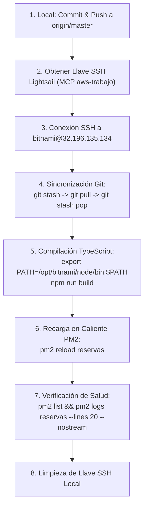

# Manual de Despliegue en AWS Lightsail - Backend Reservas Corporativas

Este manual contiene las directrices técnicas, credenciales, arquitectura de servidor y el procedimiento operativo estandarizado para realizar despliegues rápidos, seguros y sin tiempo de inactividad (Zero-Downtime) en la instancia de producción de **AWS Lightsail**.

---

## 1. Ficha Técnica de la Infraestructura

| Parámetro | Detalle |
|---|---|
| **Proveedor** | AWS Lightsail |
| **Nombre de Instancia** | `reservas-corporativas` |
| **Cuenta AWS** | `922850914172` (IAM User: `New-Dorian` / Perfil: `default`) |
| **Región / Zona** | `us-east-1` (US East - N. Virginia), Zona `us-east-1a` |
| **IP Pública** | `32.196.135.134` |
| **IP Privada** | `172.26.10.142` |
| **IPv6** | `2600:1f18:4eee:7100:616:cba7:71ee:671` |
| **Sistema Operativo** | Debian GNU/Linux 12 (bookworm) / Bitnami Node.js 18+ |
| **Hardware** | 2 vCPUs, 2 GB RAM, 60 GB SSD |
| **Usuario SSH** | `bitnami` |
| **SSH Keypair** | `LightsailDefaultKeyPair` (Región `us-east-1`) |
| **Directorio Proyecto** | `/home/bitnami/backend-reservas-corporativas` |
| **Gestor de Procesos** | PM2 (App: `reservas`, Modo: Cluster, 2 workers) |
| **Ruta Binarios Node** | `/opt/bitnami/node/bin` (`node`, `npm`, `pm2`) |
| **Puerto Interno API** | `4000` |
| **Crontab Nocturno** | `0 6 * * *` (`dist/cron/generarEstadosPagoEmpresas.run.js`) |

---

## 2. Flujo de Despliegue Rápido (Cheat Sheet)



---

## 3. Procedimiento Operativo Paso a Paso

### Paso 1: Confirmar cambios locales y subir a GitHub
Asegurarse de que todos los cambios locales estén confirmados y subidos a la rama principal:
```bash
git status
git add .
git commit -m "feat/fix: descripción del cambio"
git push origin master
```

### Paso 2: Obtener la llave SSH mediante MCP `aws-trabajo`
La llave de Lightsail se descarga dinámicamente llamando al tool `aws_call` del servidor MCP `aws-trabajo`:
* **Servicio:** `lightsail`
* **Operación:** `download-default-key-pair`
* **Región:** `us-east-1`

El resultado contiene `privateKeyBase64`. Guardar temporalmente en un archivo local (ej. `scratch/lightsail_key.pem`) y restringir permisos en Windows:
```powershell
icacls.exe "ruta\lightsail_key.pem" /inheritance:r /grant:r "$($env:USERNAME):(R)"
```

### Paso 3: Pipeline de Ejecución Remota (Comando Único)
Para agilizar el despliegue y evitar múltiples conexiones interactivas, ejecutar la secuencia completa en una sola llamada SSH:

```bash
ssh -i "ruta/lightsail_key.pem" -o StrictHostKeyChecking=no bitnami@32.196.135.134 "
  set -e
  cd /home/bitnami/backend-reservas-corporativas
  
  # 1. Preservar archivos locales modificados en el servidor
  git stash
  
  # 2. Actualizar desde origin/master
  git pull origin master
  
  # 3. Restaurar archivos preservados (si hubo stash)
  git stash pop || true
  
  # 4. Configurar PATH para acceder a los binarios de Bitnami
  export PATH=/opt/bitnami/node/bin:$PATH
  
  # 5. Compilar TypeScript y copiar assets a dist/
  npm run build
  
  # 6. Recarga sin caída de servicio (Cluster Mode)
  pm2 reload reservas
  
  # 7. Listar estado de procesos
  pm2 list
"
```

### Paso 4: Verificación Post-Despliegue
Verificar que ambos workers del cluster estén en estado `online` y sin reinicios anómalos:
```bash
ssh -i "ruta/lightsail_key.pem" -o StrictHostKeyChecking=no bitnami@32.196.135.134 "export PATH=/opt/bitnami/node/bin:\$PATH; pm2 logs reservas --lines 15 --nostream"
```

Los logs deben confirmar:
```text
Database connection established successfully.
Servidor corriendo en puerto 4000
2FA habilitado
```

### Paso 5: Limpieza de Seguridad
Eliminar de inmediato el archivo de llave privada local:
```powershell
icacls.exe "ruta\lightsail_key.pem" /grant:r "$($env:USERNAME):(F)"
Remove-Item -Force "ruta\lightsail_key.pem"
```

---

## 4. Tareas Programadas (Cron Jobs) y Estados de Pago (EDP)

El cron de Estados de Pago corre a las **06:00 UTC** (03:00 / 02:00 hora de Chile) configurado en el crontab del usuario `bitnami`:
```bash
0 6 * * * cd /home/bitnami/backend-reservas-corporativas && /opt/bitnami/node/bin/node dist/cron/generarEstadosPagoEmpresas.run.js >> /home/bitnami/cron-estados.log 2>&1
```

> [!IMPORTANT]
> El cron ejecuta **directamente los archivos compilados en `dist/`**. Por eso, el paso `npm run build` es **mandatorio** en cada despliegue para que las nuevas reglas de cobro y correo entren en vigor en el cron nocturno.

---

## 5. Resolución de Incidencias Comunes (Troubleshooting)

### A. Fallo de Git Pull por conflictos o archivos no rastreados
Si en el servidor existen scripts de prueba creados manualmente:
* **Diagnóstico:** `git status` en `/home/bitnami/backend-reservas-corporativas`.
* **Solución:**
  ```bash
  git stash
  git pull origin master
  git stash pop
  ```

### B. Error: `node: command not found` o `pm2: command not found`
En sesiones no interactivas de SSH, el entorno de Bitnami no carga automáticamente `/opt/bitnami/node/bin` en el `PATH`.
* **Solución:** Siempre prefijar el comando con:
  ```bash
  export PATH=/opt/bitnami/node/bin:$PATH
  ```

### C. Error de Permisos en la llave SSH (`Permissions are too open`)
OpenSSH rechaza llaves que tienen permisos de lectura compartidos en Windows.
* **Solución:**
  ```powershell
  icacls.exe "$key" /inheritance:r /grant:r "$($env:USERNAME):(R)"
  ```

### D. La API no responde tras el despliegue
1. Revisar logs de error de PM2:
   ```bash
   tail -n 50 /home/bitnami/.pm2/logs/reservas-error-3.log
   tail -n 50 /home/bitnami/.pm2/logs/reservas-error-4.log
   ```
2. Si un worker quedó congelado, forzar reinicio completo:
   ```bash
   pm2 restart reservas
   ```

