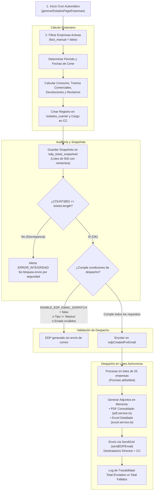

# Manual Operativo y Técnico: Envío Automático de Estados de Pago (EDP) por Correo

Este manual documenta de forma exhaustiva el funcionamiento, arquitectura, reglas de negocio, validaciones de seguridad, monitoreo y resolución de incidencias del **proceso de despacho automático de Estados de Pago (EDP)** a través de correo electrónico en la plataforma de Reservas Corporativas.

---

## 1. Visión General y Objetivos

El sistema agrupa periódicamente todos los pasajes emitidos y anulados por las empresas clientes en un período contable determinado (mensual o quincenal). Al consolidar este ciclo, el sistema genera automáticamente:

1. **Un registro formal de Estado de Pago (EDP)** en la base de datos con cargos a la cuenta corriente.
2. **Un congelamiento inmutable (Snapshots)** de los datos del período para auditoría contable.
3. **El despacho transaccional por correo electrónico** a los contactos de facturación y ejecutivos comerciales de la empresa, adjuntando el **PDF Consolidado** y la **Planilla Excel detallada**.

---

## 2. Arquitectura de Módulos Involucrados

| Componente | Archivo / Recurso | Rol en el Flujo |
|---|---|---|
| **Disparador Cron** | `src/cron/generarEstadosPagoEmpresas.run.ts` | Entry point para ejecución programada nocturna (Linux Crontab / Task Scheduler). |
| **Orquestador Principal** | `src/cron/generarEstadosPagoEmpresas.ts` | Evalúa fechas de corte, calcula saldos, valida integridad y encola despachos. |
| **Snapshot Engine** | `src/models/edp_ticket_snapshot.model.ts` | Congela de forma inmutable los boletos y centros de costo asociados al EDP. |
| **Mail Batch Dispatcher** | `src/services/edpMailBatch.service.ts` | Gestor de cola asíncrona, validación de destinatarios y control de lotes (chunks). |
| **Generador de PDF** | `src/services/pdf.service.ts` | Renderiza en memoria el informe ejecutivo consolidado por centros de costo. |
| **Generador de Excel** | `src/services/excel.service.ts` | Construye en memoria la planilla Excel con el detalle línea a línea de tickets. |
| **Servicio de Envío** | `src/services/mail.service.ts` | Conexión con SendGrid API, ensamblado del correo HTML y adjuntos en Base64. |
| **Script de Reenvío** | `src/script/resendEDPEmailsToday.ts` | Herramienta operativa para reenvío masivo on-demand en caso de contingencia. |

---

## 3. Diagrama de Flujo del Proceso



---

## 4. Requisitos y Condiciones Previas para el Envío

Para que una empresa reciba efectivamente el correo automático con su Estado de Pago, el sistema evalúa estrictamente las siguientes compuertas lógicas:

### 4.1. Habilitación en Variables de Entorno (`.env`)
El envío masivo requiere tener activa la bandera:
```env
ENABLE_EDP_EMAIL_DISPATCH=true
```
> [!NOTE]
> Si la variable es `false` o no está definida, el cron generará los Estados de Pago, persistirá los datos y actualizará los saldos de la cuenta corriente, pero **omitirá el despacho de correos**.

### 4.2. Tipo de Facturación de la Empresa
El sistema distingue dos modalidades de facturación en la tabla `empresas`:
- **`tipo_facturacion = "Masiva"`:** **Apta para envío automático.** Corresponde a empresas cuyo flujo de facturación estándar es el despacho directo de reportes consolidados.
- **`tipo_facturacion = "Especial"`:** **Se omite del despacho masivo.** Requiere tratamiento manual o formatos ad-hoc gestionados directamente por el área de facturación/contraloría.

### 4.3. Validación Estricta de Destinatarios (Regex)
Los correos destinatarios se obtienen de las columnas de la tabla `empresas`:
- **Destinatarios directos (`To`):** `contacto_fact_email` y `ejecutivo_com_email`.
- **Destinatarios en copia (`Cc`):** `contacto_fact_email_cc` (soporta múltiples correos separados por comas o punto y coma).

**Filtro aplicado:**
```typescript
const emailRegex = /^[^\s@]+@[^\s@]+\.[^\s@]+$/;
```
Cualquier dirección que no cumpla con este formato (por ejemplo, celdas vacías, espacios o textos como `"Sin Informacion"` o `"no tiene"`) es descartada automáticamente. Si la empresa no cuenta con al menos un correo válido, se registra en consola y se omite el envío para esa empresa sin generar caídas en el proceso.

### 4.4. Control de Integridad de Snapshots (Snapshots Check)
Antes de autorizar el envío, el sistema ejecuta una verificación directa:
```typescript
const countBD = await EdpTicketSnapshot.count({ where: { edp_id: estadoCuenta.id } });
const snapshotsGuardadosCorrectamente = countBD === tickets.length;
```
* Si el conteo en base de datos es idéntico a la cantidad de tickets calculados, se autoriza el encolamiento.
* Si existe la más mínima discrepancia, se emite una alerta crítica de logs y **se aborta el envío del correo** para evitar despachar al cliente cifras incompletas o discordantes.

---

## 5. Generación de Archivos Adjuntos en Memoria

Para optimizar recursos y no depender de almacenamiento en disco temporal, los anexos se generan en caliente directamente como buffers de memoria:

### 5.1. PDF Consolidado (`generateEDPPDF`)
- **Archivo:** `src/services/pdf.service.ts`
- **Nombre de archivo adjunto:** `EDP-[NombreEmpresa]-[Periodo].pdf`
- **Contenido:**
  - Identificación tributaria (RUT, Razón Social, Cuenta Corriente, N° EDP, Período de facturación).
  - Resumen de boletos confirmados y anulados.
  - Consumo bruto, porcentaje y monto de descuento por tramos comerciales aplicados.
  - Devoluciones aplicadas y reclamos aceptados.
  - Tabla consolidada por **Centros de Costo** con cantidad de pasajes y montos, ordenada de mayor a menor consumo.

### 5.2. Planilla Excel de Detalle (`generateEDPExcelBuffer`)
- **Archivo:** `src/services/excel.service.ts`
- **Nombre de archivo adjunto:** `tickets_edp_[Periodo]_[CuentaCorriente].xlsx`
- **Contenido:**
  - Hoja de cálculo con el desglose unitario de cada boleto del período: número de ticket, código de reserva, nombre y RUT del pasajero, centro de costo imputado, fecha del viaje, servicio/asiento, origen, destino, tarifa unitaria, recargo comercial, estado del boleto y montos de devolución en caso de anulación.

---

## 6. Despacho en Lotes Asíncronos (Batch Processing)

El despacho de correos se gestiona en `src/services/edpMailBatch.service.ts`:

1. **Tamaño del lote (`CHUNK_SIZE = 25`):** Las empresas listas para despacho se agrupan en lotes de hasta 25 empresas simultáneas.
2. **Aislamiento de fallos con `Promise.allSettled`:**
   - Si una empresa experimenta un rechazo por buzón lleno o rebote en SendGrid, **no detiene ni afecta el envío de las otras 24 empresas del lote**.
3. **Control de límites y estabilidad:** Evita sobrepasar los límites de concurrencia y conexiones abiertas hacia la API de SendGrid.

---

## 7. Monitoreo, Logs y Trazabilidad

Durante la ejecución del cron o proceso de envío, se emiten logs con marca de tiempo en zona horaria chilena (`America/Santiago`):

```text
[2026-11-04T03:00:00.000Z] === INICIO generarEstadosPagoEmpresas (Hora Chile: 2026-11-04 00:00:00) ===
[2026-11-04T03:00:02.000Z] Empresas encontradas: 45
[2026-11-04T03:00:05.000Z] Procesando empresa ID: 12 (Empresa Ejemplo SpA)
[2026-11-04T03:00:10.000Z] Snapshots guardados: 154 tickets. Verificación OK: true
[2026-11-04T03:00:45.000Z] Iniciando envio de emails EDP para 38 EDPs...
[EDP Mail Queue] Procesando 38 EDPs de tipo Masiva en lotes de 25...
[EDP Mail Queue] Lote 1: 25 items
[EDP Mail Queue] Lote 2: 13 items
[EDP Mail Queue] Finalizado — ✅ 38 enviados, ❌ 0 fallidos
[2026-11-04T03:01:15.000Z] === FIN generarEstadosPagoEmpresas ===
```

---

## 8. Guía de Solución de Problemas (Troubleshooting)

### ¿Por qué una empresa no recibió el correo del EDP?

| Causa Común | Verificación | Solución |
|---|---|---|
| **Facturación Manual activada** | Campo `fact_manual = true` en tabla `empresas`. | Desactivar la casilla en la ficha de la empresa si requiere cobro automático. |
| **Tipo de facturación Especial** | Campo `tipo_facturacion = "Especial"`. | Si debe recibir correos masivos, cambiar el tipo a `"Masiva"`. |
| **Correo mal formateado o ausente** | `contacto_fact_email` vacío o con texto descriptivo como `"Sin Información"`. | Ingresar una dirección de correo válida con formato `nombre@dominio.cl`. |
| **Fallo en comprobación de integridad** | El número de snapshots no coincidió con los tickets calculados (`countBD !== tickets.length`). | Revisar logs buscando `ERROR_INTEGRIDAD`. Ejecutar regeneración con `src/script/regenerateEDPSnapshots.ts`. |
| **Bandera general inactiva** | `ENABLE_EDP_EMAIL_DISPATCH` está en `false` en el entorno. | Configurar `ENABLE_EDP_EMAIL_DISPATCH=true` en el `.env` del backend y reiniciar el servicio. |

---

## 9. Scripts Operativos de Contingencia

En caso de requerir pruebas o recuperación tras una caída de red externa:

- **Reenviar correos de EDP generados en la fecha:**
  ```bash
  npx ts-node src/script/resendEDPEmailsToday.ts
  ```
- **Probar envío de un correo individual de prueba:**
  ```bash
  npm run test:edp-email
  # O bien:
  npx ts-node src/script/testSendEDPEmailServer.ts
  ```
- **Reconstruir snapshots de un EDP sin histórico:**
  ```bash
  npx ts-node src/script/regenerateEDPSnapshots.ts
  ```

