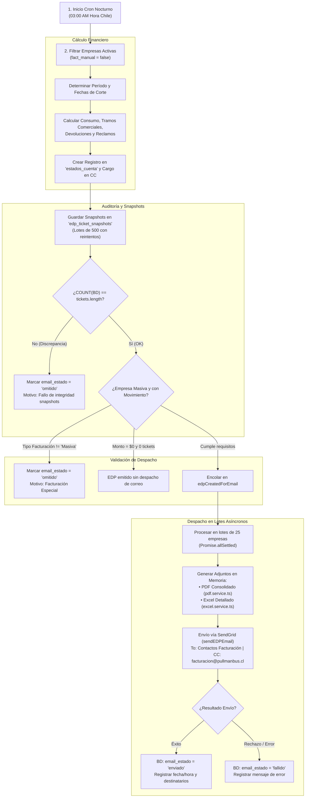

# Manual Operativo y Técnico: Envío y Auditoría de Estados de Pago (EDP) por Correo

Este manual documenta de forma exhaustiva el funcionamiento, arquitectura, reglas de negocio, validaciones de seguridad, persistencia en base de datos, módulos de interfaz web y resolución de incidencias del **proceso de despacho y trazabilidad de Estados de Pago (EDP)** a través de correo electrónico en la plataforma de Reservas Corporativas.

---

## 1. Visión General y Objetivos

El sistema consolida periódicamente todos los pasajes emitidos y anulados por las empresas clientes en un período contable determinado (mensual o quincenal). Al liquidar este ciclo, el sistema genera de forma integrada:

1. **Un registro formal de Estado de Pago (EDP)** en la base de datos con aplicación de cargos contables a la cuenta corriente.
2. **Un congelamiento inmutable (Snapshots)** de los datos del período para auditoría contable histórica.
3. **El despacho transaccional por correo electrónico** a los contactos de facturación y ejecutivos comerciales de la empresa, adjuntando el **PDF Consolidado** y la **Planilla Excel detallada**, con copia obligatoria en `CC` a `facturacion@pullmanbus.cl`.
4. **Trazabilidad completa en Base de Datos**: Registro en tiempo real del estado de entrega (`enviado`, `omitido`, `fallido`, `pendiente`), fecha/hora exacta, destinatarios y motivo de omisión o fallo.
5. **Módulo de Gestión y Auditoría en Frontend ("Envíos EDP")**: Interfaz para supervisión en vivo con KPIs, filtros por fechas/estado/empresa, descarga en Excel y reenvío manual bajo demanda.

---

## 2. Arquitectura de Módulos Involucrados

| Componente | Archivo / Recurso | Rol en el Flujo |
|---|---|---|
| **Disparador Cron Nocturno** | `src/cron/generarEstadosPagoEmpresas.run.ts` | Entry point para ejecución programada nocturna a las 06:00 UTC (Linux Crontab). |
| **Orquestador Principal** | `src/cron/generarEstadosPagoEmpresas.ts` | Evalúa fechas de corte, calcula saldos, valida integridad y encola despachos masivos. |
| **Modelo y Trazabilidad BD** | `src/models/estado_cuenta.model.ts` | Define los campos `email_estado`, `email_fecha_envio`, `email_destinatarios`, `email_motivo`. |
| **Snapshot Engine** | `src/models/edp_ticket_snapshot.model.ts` | Congela de forma inmutable los boletos y centros de costo asociados al EDP. |
| **Mail Batch Dispatcher** | `src/services/edpMailBatch.service.ts` | Gestor de cola asíncrona, control de lotes (`CHUNK_SIZE = 25`), reenvío unitario y persistencia en BD. |
| **Generador de PDF** | `src/services/pdf.service.ts` | Renderiza en memoria el informe ejecutivo consolidado por centros de costo. |
| **Generador de Excel** | `src/services/excel.service.ts` | Construye en memoria la planilla Excel con el detalle línea a línea de tickets. |
| **Servicio de Envío SMTP** | `src/services/mail.service.ts` | Conexión con SendGrid API, ensamblado del correo HTML y adjuntos en Base64. |
| **Controlador de API** | `src/controllers/estadoCuenta.controller.ts` | Endpoints de reporte con KPIs, exportación Excel corporativo y reenvío manual. |
| **Rutas de API** | `src/routes/estadoCuenta.routes.ts` | Expone `/reporte-envios`, `/reporte-envios/excel` y `/:id/reenviar-email`. |
| **Vista Frontend** | `components/super-components/super-edp-mail-reports.tsx` | Componente interactivo de reportabilidad integrado en los paneles de administración. |

---

## 3. Diagrama de Flujo del Proceso



---

## 4. Persistencia y Trazabilidad en Base de Datos

Cada fila en la tabla `estados_cuenta` posee trazabilidad auditada de su ciclo de comunicación a través de cuatro columnas dedicadas:

| Campo | Tipo | Valor por Defecto | Propósito y Valores Posibles |
|---|:---:|:---:|---|
| **`email_estado`** | `ENUM` | `'pendiente'` | • `'pendiente'`: EDP creado manualmente o aún en espera de despacho.<br>• `'enviado'`: Correo despachado con éxito por SendGrid.<br>• `'omitido'`: Despacho descartado por regla (empresa especial, sin correo o \$0).<br>• `'fallido'`: Error devuelto por la API de SendGrid o timeout. |
| **`email_fecha_envio`** | `DATETIME` | `NULL` | Fecha y hora exacta (timestamp) en que SendGrid confirmó la recepción del mensaje. |
| **`email_destinatarios`** | `TEXT` | `NULL` | Lista consolidada de direcciones `TO` y `CC` utilizadas en el despacho. |
| **`email_motivo`** | `VARCHAR(255)` | `NULL` | Razón descriptiva (ej.: *"Facturación Especial (gestión manual)"*, *"Sin emails destinatarios configurados"*, *"Envío automático nocturno"* o descripción del error técnico). |

---

## 5. Requisitos y Reglas de Negocio del Despacho

### 5.1. Copia Mandatoria a Facturación Pullman Bus
> [!IMPORTANT]
> Todo envío automático o reenvío manual de Estado de Pago a empresas masivas incluye de forma obligatoria la copia en `CC` a:
> **`facturacion@pullmanbus.cl`**

### 5.2. Tipo de Facturación de la Empresa
- **`tipo_facturacion = "Masiva"`**: Habilitada para despacho automático.
- **`tipo_facturacion = "Especial"`**: Se omite automáticamente marcando `email_estado = 'omitido'` y motivo *"Facturación Especial (gestión manual)"*.

### 5.3. Validación Estricta de Destinatarios (Regex)
Los correos se obtienen de la ficha de la empresa:
- **`TO` (Directos):** `contacto_fact_email` y `ejecutivo_com_email`.
- **`CC` (Copia):** `contacto_fact_email_cc` (soporta múltiples direcciones separadas por comas o punto y coma) + `facturacion@pullmanbus.cl`.

Filtro aplicado:
```typescript
const emailRegex = /^[^\s@]+@[^\s@]+\.[^\s@]+$/;
```
Si la empresa no posee ninguna dirección válida que cumpla el patrón, el EDP se marca como `'omitido'` con el motivo *"Sin emails destinatarios configurados"*.

### 5.4. Verificación de Integridad de Snapshots
Antes de autorizar el envío:
```typescript
const countBD = await EdpTicketSnapshot.count({ where: { edp_id: estadoCuenta.id } });
const snapshotsGuardadosCorrectamente = countBD === tickets.length;
```
Si hay discordancia, el envío se suspende de inmediato y el EDP queda marcado como `'omitido'` por *"Fallo de integridad de snapshots"*.

---

## 6. Diferenciación Operativa: Proceso Nocturno vs Facturación Manual

| Característica | Proceso Nocturno Automático (Cron) | Facturación Manual desde el Panel |
|---|---|---|
| **Disparador** | Crontab Linux (`0 6 * * *` UTC / 03:00 AM Chile). | Botón *"Generar Estado de Pago"* en la interfaz. |
| **Endpoint / Archivo** | `dist/cron/generarEstadosPagoEmpresas.run.js` | `POST /api/estado-cuenta/generar` |
| **Empresas evaluadas** | Todas las empresas con corte hoy y `fact_manual = false`. | Únicamente la empresa seleccionada por el usuario. |
| **Despacho de Correo** | **Automático inmediato** vía `processEDPMailQueue`. | **No envía correo automáticamente** (Previene envíos involuntarios). |
| **Estado Inicial** | Pasa directamente a `'enviado'` u `'omitido'`. | Queda en estado **`'pendiente'`**. |
| **Acción Requerida** | Ninguna (Monitoreo pasivo en panel). | El supervisor revisa las cifras y hace clic en **"Reenviar"** para despachar. |

---

## 7. Módulo de Reportería y Gestión en el Frontend ("Envíos EDP")

La vista **"Envíos EDP"** (`SuperEdpMailReports`) centraliza la gestión y auditoría en tiempo real:

### 7.1. Tarjetas de Indicadores Clave (KPIs)
- **Total Generados:** Cantidad de EDPs en el rango temporal seleccionado.
- **Enviados con Éxito:** Total entregados vía SendGrid.
- **Omitidos por Regla:** Total descartados justificadamente (Especiales, sin correo, \$0).
- **Fallidos / Error:** Total con error de transporte SMTP.
- **Tasa de Entrega:** Porcentaje de efectividad del despacho masivo.

### 7.2. Herramientas de Filtrado y Búsqueda
- **Rango de Fechas:** Filtro Desde / Hasta por fecha de generación contable.
- **Estado de Envío:** Selector entre *Todos*, *Enviados*, *Omitidos*, *Fallidos* y *Pendientes*.
- **Selector de Empresa:** Búsqueda rápida por Razón Social o RUT.
- **Buscador de Texto:** Filtrado en tiempo real por número de EDP, RUT o destinatarios.
- **Exportación Excel Corporativo:** Descarga directa de la planilla formateada con estilos oficiales Pullman Bus, formato de moneda chilena (`$ #,##0`), badges y totales.

### 7.3. Botón de Reenvío On-Demand ("Reenviar")
Permite a los supervisores reintentar el despacho de cualquier EDP en estado *Pendiente* o *Fallido*:
- Despliega confirmación interactiva con SweetAlert2 mostrando empresa, monto y destinatarios.
- Reconstruye en memoria el PDF y Excel exactos a partir de los snapshots inmutables.
- Despacha a la empresa con copia a `facturacion@pullmanbus.cl`.
- Actualiza en base de datos `email_estado = 'enviado'` con la fecha/hora actual y motivo *"Reenviado manualmente por supervisor"*.

---

## 8. Matriz de Roles y Control de Acceso

| Rol | Panel / Ruta | Visualización de Reporte y Excel | Reenvío Manual ("Reenviar") | Alcance Multi-Empresa |
|---|:---:|:---:|:---:|---|
| **`superuser`** | `/superuser` | **Sí** | **Sí** | **Global** (Todas las empresas). |
| **`contralor`** | `/controller` | **Sí** | **Sí** | **Global** (Todas las empresas). |
| **`admincc`** | `/admincc` | **Sí** | **Sí** | **Global** (Todas las empresas). |
| **`auditoria`** | `/auditoria` | **Sí** | Según permisos | **Global** (Todas las empresas). |
| **`admin`** | `/admin` | **Sí** | No | **Aislado**: Bloqueado estrictamente a su propia empresa (`user.companyId`). |

---

## 9. Endpoints de la API Backend

Todos los endpoints requieren autenticación mediante cabecera `Authorization: Bearer <token>`:

### 1. `GET /api/estado-cuenta/reporte-envios`
- **Permiso:** `estados_de_pago_ver_informacion_de_estados_de_pago`
- **Query Params:** `desde`, `hasta`, `estado`, `empresaId`, `search`, `page`, `limit`.
- **Respuesta:** Objeto con métricas (`kpis`), listado paginado (`edps`) y paginación (`pagination`).

### 2. `GET /api/estado-cuenta/reporte-envios/excel`
- **Permiso:** `estados_de_pago_ver_informacion_de_estados_de_pago`
- **Query Params:** Mismos filtros que el listado.
- **Respuesta:** Archivo binario `application/vnd.openxmlformats-officedocument.spreadsheetml.sheet` descargable.

### 3. `POST /api/estado-cuenta/:id/reenviar-email`
- **Permiso:** `estados_de_pago_crear_edp_manual`
- **Respuesta:** `{ success: true, message: "EDP #... reenviado exitosamente a ...", recipients: [...], cc: [...] }`.

---

## 10. Guía de Solución de Problemas (Troubleshooting)

### A. El EDP figura como "Pendiente" y no se envió por correo
* **Causa 1:** El EDP fue creado mediante **Facturación Manual** desde el panel web.  
  *Solución:* Presionar el botón **"Reenviar"** en la fila correspondiente para disparar el correo.
* **Causa 2:** El EDP tiene monto \$0 y 0 tickets.  
  *Comportamiento esperado:* El sistema no envía correos vacíos a los clientes.

### B. El EDP figura como "Omitido"
* **Causa 1 (Facturación Especial):** La empresa tiene `tipo_facturacion = 'Especial'`.  
  *Solución:* Si debe recibir correos masivos, cambiar el tipo a `'Masiva'` en el mantenedor de empresas.
* **Causa 2 (Sin correos configurados):** La empresa no tiene correos válidos en `contacto_fact_email`.  
  *Solución:* Actualizar la ficha de la empresa con un correo válido y presionar **"Reenviar"**.
* **Causa 3 (Fallo de integridad):** Discrepancia en snapshots.  
  *Solución:* Ejecutar el script `src/script/regenerateEDPSnapshots.ts` para reparar los snapshots.

### C. El EDP figura como "Fallido"
* **Causa:** Rechazo devuelto por SendGrid (dirección bloqueada, rebote duro o error de red).
* **Solución:** Leer el detalle del error en la columna *Motivo / Detalle*, corregir la casilla de correo del cliente y presionar **"Reenviar"**.

---

## 11. Comandos de Verificación en Servidor

Para revisar los logs del último envío nocturno en la consola de AWS Lightsail:

```bash
# Ver las últimas líneas del registro del cron nocturno
tail -n 80 /home/bitnami/cron-estados.log

# Ver logs de la API en vivo
pm2 logs reservas --lines 50 --nostream
```
